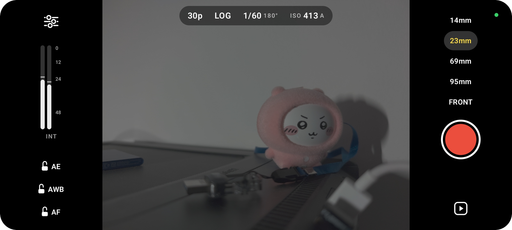

<p align="center">
  <picture>
    <source media="(prefers-color-scheme: dark)" srcset="assets/hero-dark.svg">
    
  </picture>
</p>

<p align="center">
  <a href="#why-log">Why log</a>&nbsp;&nbsp;·&nbsp;&nbsp;<a href="#how-it-works">How it works</a>&nbsp;&nbsp;·&nbsp;&nbsp;<a href="#in-resolve">In Resolve</a>&nbsp;&nbsp;·&nbsp;&nbsp;<a href="#measurements">Measurements</a>&nbsp;&nbsp;·&nbsp;&nbsp;<a href="#build">Build</a>
</p>

<p align="center">
  <b>Development prototype.</b> Built for and tested on the Xiaomi 15 Ultra.
</p>

<p align="center">
  
</p>

<p align="center"><sub>Screenshot from the Xiaomi 15 Ultra. Settings, sound level and locks on the left; lenses, record button and clips on the right.</sub></p>

<br>

<h2 align="center" id="why-log">Why log</h2>

<p align="center">
  A phone’s camera app finishes the picture before it saves it: it adds contrast and sharpening and lets bright skies clip.<br>
  That can’t be undone in the grade. Latitude records a flat Apple Log image, so the highlights are still in the file.
</p>

<p align="center">
  <picture>
    <source media="(prefers-color-scheme: dark)" srcset="assets/why-dark.svg">
    
  </picture>
</p>

<p align="center"><sub>The curves illustrate the idea. They aren’t measured from a particular phone.</sub></p>

<br>

<h2 align="center" id="how-it-works">How it works</h2>

<p align="center">
  <picture>
    <source media="(prefers-color-scheme: dark)" srcset="assets/how-it-works-dark.svg">
    
  </picture>
</p>

<p align="center">
  <picture>
    <source media="(prefers-color-scheme: dark)" srcset="assets/principles-dark.svg">
    
  </picture>
</p>

<br>

<h2 align="center" id="in-resolve">In Resolve</h2>

<p align="center">
  Resolve already has Apple Log (Rec.2020 primaries) as an input color space.<br>
  A metadata key in the file makes Resolve select it on import, without a LUT or manual tagging.<br>
  Lens, ISO, shutter angle, white balance and a time-of-day timecode show up in the metadata panel.
</p>

<p align="center">
  <picture>
    <source media="(prefers-color-scheme: dark)" srcset="assets/pipeline-dark.svg">
    
  </picture>
</p>

<p align="center"><sub>Checked with DaVinci Resolve Studio 21.1 on Linux. Sound is 24-bit PCM, because Resolve on Linux can’t decode AAC.<br>If a phone ignores the custom tone curve in 10-bit, Latitude records locked HLG instead. It doesn’t convert HLG to log, which would add no information.</sub></p>

<br>

<h2 align="center" id="measurements">Measurements</h2>

<p align="center">
  Measured on the Xiaomi 15 Ultra: startup time from the app’s log, frame timing with <code>ffprobe</code>,<br>
  lip sync with a clap test, and levels from the decoded code values.
</p>

<p align="center">
  <picture>
    <source media="(prefers-color-scheme: dark)" srcset="assets/measured-dark.svg">
    
  </picture>
</p>

<div align="center">

| Stage | What | Status |
| :--- | :--- | :--- |
| 0 | Probe what the camera, image processor and encoder support | Done |
| 1 | HLG 10-bit with exposure, white balance and focus locked | Done |
| 2 | Apple Log through the image processor’s tone curve, set by Resolve on import | Done |
| 3 | RAW to Apple Log on the GPU | Parked |

</div>

<p align="center">
  <b>Working today:</b> volume-button recording, AE · AWB · AF lock, open gate 4096×3072 HEVC 10-bit at 150 Mbit/s,<br>
  Apple Log · HLG · Rec.709, matched colors on every lens, 24-bit PCM sound, crash-safe files, zebras,<br>
  thermal warning, standby after 90 seconds, timecode and lens metadata.
</p>

<br>

<h2 align="center" id="build">Build</h2>

<p align="center">
  Android 14 or later. Kotlin, Jetpack Compose and Camera2.<br>
  Needs JDK 21 and the Android SDK; the scripts expect them in <code>~/Android</code>.
</p>

```sh
scripts/setup-usb.sh           # once: allow adb to reach the phone over USB (asks for sudo)
scripts/phone.sh               # build the optimized app, install it and show the startup time
scripts/phone.sh pull          # copy probe results and test clips into testclips/
python3 scripts/readme-art.py  # redraw the illustrations in assets/
```

<br>

<p align="center">
  <picture>
    <source media="(prefers-color-scheme: dark)" srcset="assets/wordmark-dark.svg">
    
  </picture>
</p>
