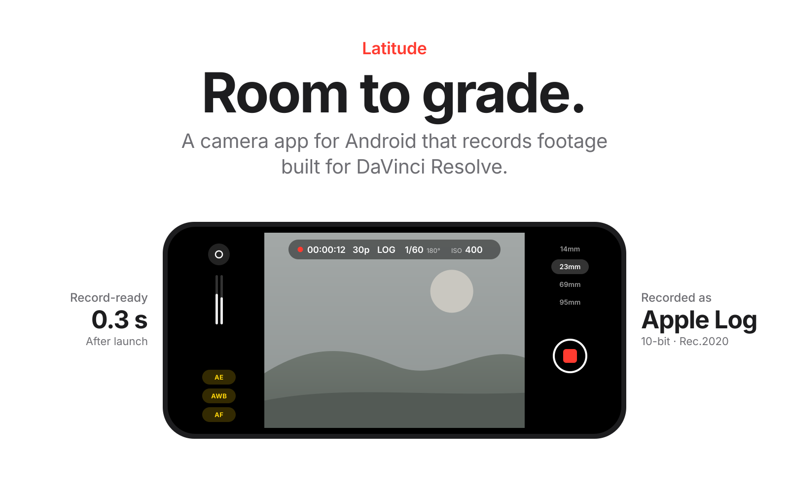
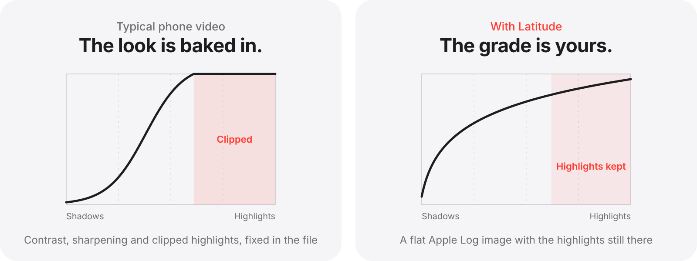
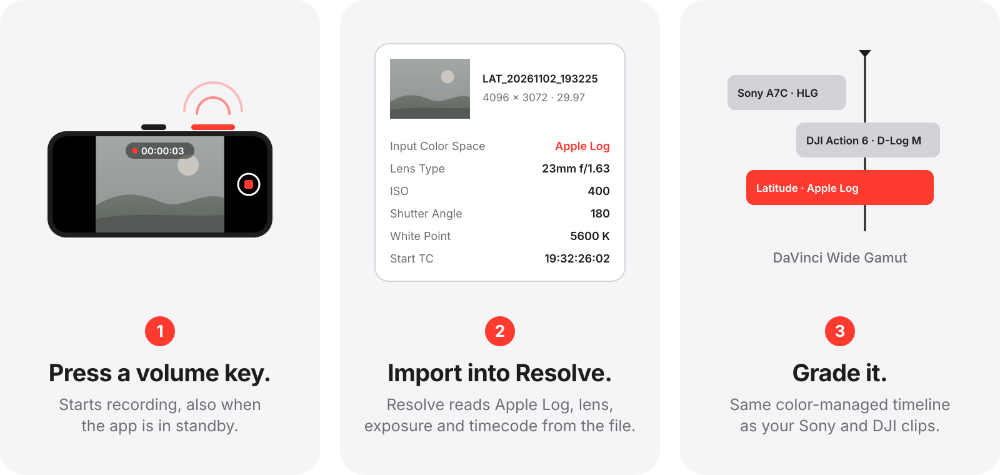
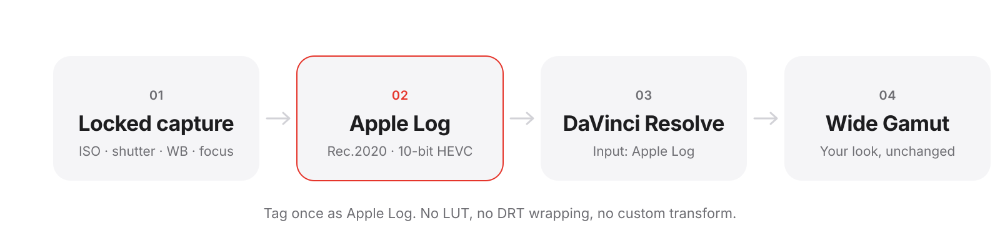
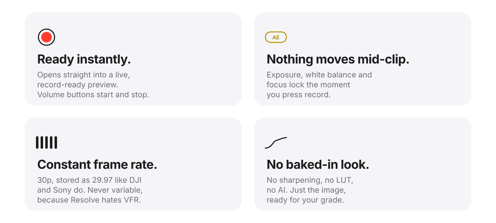
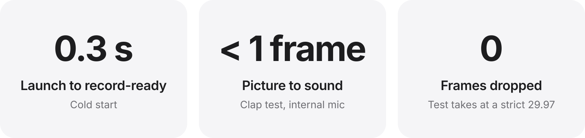

<p align="center">
  <picture>
    <source media="(prefers-color-scheme: dark)" srcset="assets/hero-dark.svg">
    
  </picture>
</p>

<p align="center">
  <a href="#why">Why</a>&nbsp;&nbsp;·&nbsp;&nbsp;<a href="#how-it-works">How it works</a>&nbsp;&nbsp;·&nbsp;&nbsp;<a href="#principles">Principles</a>&nbsp;&nbsp;·&nbsp;&nbsp;<a href="#measured">Measured</a>&nbsp;&nbsp;·&nbsp;&nbsp;<a href="#build">Build</a>
</p>

<p align="center">
  <b>Development prototype.</b> Built for and tested on the Xiaomi 15 Ultra.
</p>

<br>

<h2 align="center" id="why">Leave the look for later.</h2>

<p align="center">
  A phone’s camera app finishes the picture before it is saved: contrast, sharpening, clipped skies.<br>
  Latitude records a flat Apple Log image instead and leaves the look to your grade.
</p>

<p align="center">
  <picture>
    <source media="(prefers-color-scheme: dark)" srcset="assets/why-dark.svg">
    
  </picture>
</p>

<p align="center"><sub>Curves drawn to show the idea, not measured from a particular phone.</sub></p>

<br>

<h2 align="center" id="how-it-works">Record. Import. Grade.</h2>

<p align="center">
  The app opens ready to record. Resolve knows what the clip is the moment it lands in the media pool.
</p>

<p align="center">
  <picture>
    <source media="(prefers-color-scheme: dark)" srcset="assets/how-it-works-dark.svg">
    
  </picture>
</p>

<br>

<h2 align="center" id="resolve">Lands natively in Resolve.</h2>

<p align="center">
  Latitude records Apple Log on Rec.2020 primaries, a curve DaVinci Resolve already knows.<br>
  Resolve sets the input color space by itself, and the clip arrives in DaVinci Wide Gamut next to every other camera.
</p>

<p align="center">
  <picture>
    <source media="(prefers-color-scheme: dark)" srcset="assets/pipeline-dark.svg">
    
  </picture>
</p>

<p align="center"><sub>Apple Log needs the phone’s image processor to honor a custom tone curve in 10-bit.<br>Where it doesn’t, Latitude records clean, locked HLG instead. It never fakes log from an HLG image.</sub></p>

<br>

<h2 align="center" id="principles">Built to be trusted.</h2>

<p align="center">
  A phone that changes exposure mid-take, sharpens every edge and drifts in frame rate is hard to grade.<br>
  Latitude is designed around the opposite.
</p>

<p align="center">
  <picture>
    <source media="(prefers-color-scheme: dark)" srcset="assets/principles-dark.svg">
    
  </picture>
</p>

<br>

<h2 align="center" id="measured">Measured, not promised.</h2>

<p align="center">
  Every stage ships only after it passes measurement on the device:<br>
  grey card and exposure series, raw code values, frame timing with <code>ffprobe</code>, a clap test for lip sync.
</p>

<p align="center">
  <picture>
    <source media="(prefers-color-scheme: dark)" srcset="assets/measured-dark.svg">
    
  </picture>
</p>

<div align="center">

| Stage | What | Status |
| :--- | :--- | :--- |
| 0 | Capability probe: what the camera, ISP and encoder really offer | Done |
| 1 | Clean HLG 10-bit with exposure, white balance and focus locked | Done |
| 2 | Apple Log through the ISP tone curve, recognized by Resolve on import | Done |
| 3 | RAW to Apple Log on the GPU | Parked |

</div>

<p align="center">
  <b>Working today:</b> instant-start pipeline, volume-button recording, AE · AWB · AF lock,<br>
  open gate 4096×3072 HEVC 10-bit at 150 Mbit/s, Apple Log · HLG · Rec.709, matched colors on every lens,<br>
  24-bit PCM sound (Resolve on Linux decodes no AAC), crash-safe files, zebras, thermal warning,<br>
  time-of-day timecode, lens · ISO · shutter angle · white balance in Resolve’s metadata panel.
</p>

<br>

<h2 align="center" id="build">Build and run.</h2>

<p align="center">
  Android 14 or later. Kotlin, Jetpack Compose and Camera2.<br>
  Needs JDK 21 and the Android SDK; the scripts expect them in <code>~/Android</code>.
</p>

```sh
scripts/setup-usb.sh           # once: allow adb to reach the phone over USB (asks for sudo)
scripts/phone.sh               # build the optimized app, install it and show the startup time
scripts/phone.sh pull          # copy probe results and test clips into testclips/
python3 scripts/readme-art.py  # redraw the illustrations in assets/
```

<br>
<br>

<p align="center">
  <picture>
    <source media="(prefers-color-scheme: dark)" srcset="assets/wordmark-dark.svg">
    
  </picture>
</p>

<p align="center"><b>Room to grade.</b></p>
